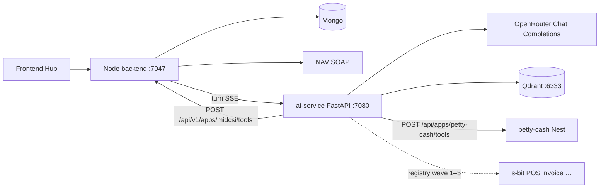

# CSI System Hub (MIDCSI)

Staff hub: katalog aplikasi, dokumentasi, sales order, dan copilot internal. Bukan chatbot toko. Agen boleh menyusun **draf** SO; staf menekan Kirim. NAV tidak dipanggil dari loop LLM.

## Alur



| Proses | Isi |
|---|---|
| `frontend/` | SPA Hub |
| `backend/` | Auth, CRUD, tool Mongo/NAV, sesi chat, SSE ke browser (`backend/agent/` = pintu + data, bukan otak produksi) |
| `ai-service/` | Otak agen: loop, Qdrant, `registry/catalog.json` (16 app; `midcsi` + `petty-cash` enabled) |
| `infra/qdrant/` | Vector DB |
| `python/rag_eval/` | Eval hit@k / MRR (bukan serving) |

Otak agen hanya `ai-service`. Hub adalah klien chat + REST tool MIDCSI. `AI_SERVICE_URL` wajib di staging/produksi; kalau Python mati, chat error, tidak pindah ke loop Node. Loop di `orchestrator.js` hanya untuk tes yang inject `complete`/`execute`.

## Jalanin

```bash
# Qdrant
bash scripts/start-qdrant.sh
# Hub
cd backend && pnpm dev
# AI (opsional)
cd ai-service && python3 -m venv .venv && . .venv/bin/activate && pip install -e ".[dev]"
uvicorn app.main:app --host 127.0.0.1 --port 7080
```
